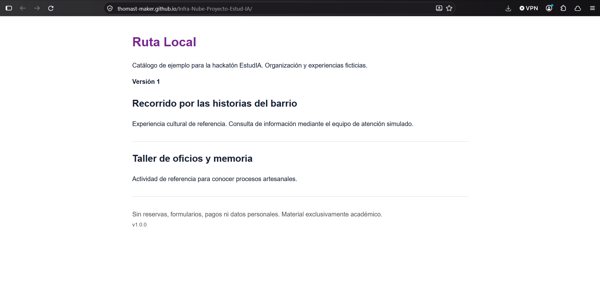
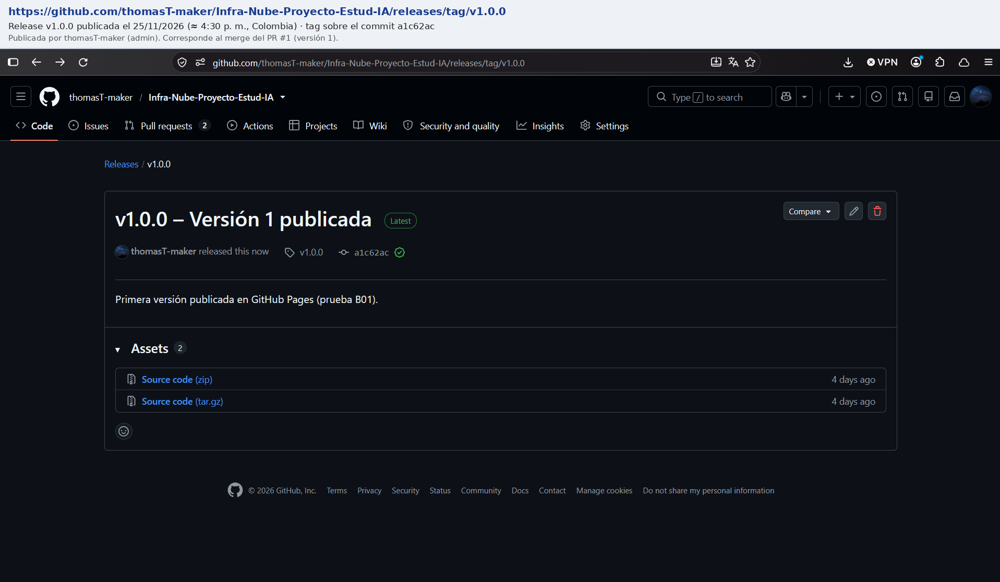
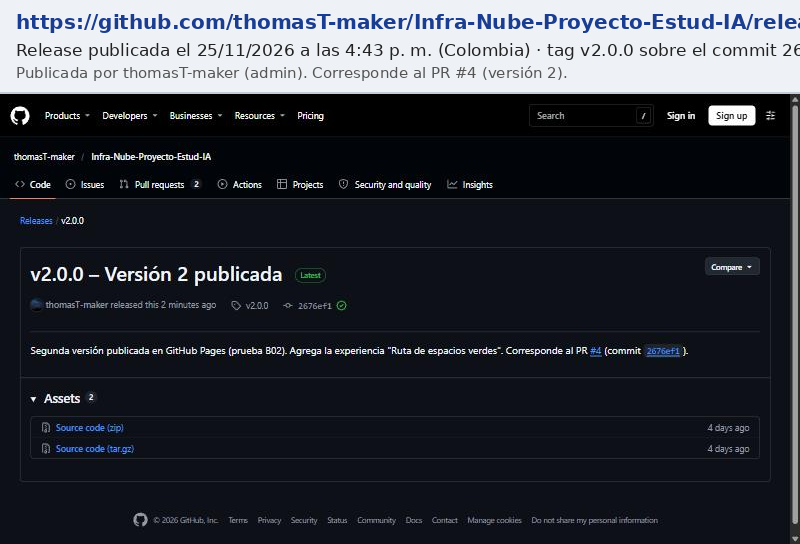

# Bitácora del equipo

Basada en `PLANTILLA_EVIDENCIAS.md` del paquete del reto. Los campos marcados con *[completar]* se llenan durante el encuentro 2. **No escribir contraseñas, tokens ni claves.** Las capturas se guardan en `documentacion/evidencias/`.

## Registro del equipo

- **Equipo:** *[completar]*
- **Integrantes y responsabilidades:** *[completar: nombre — usuario GitHub — rol (admin / revisor / actualiza / documenta / repite B06)]*
- **Fecha:** 21 de noviembre de 2026 (encuentro 2)
- **Modalidad:** nube (GitHub Pages)
- **Arquitectura elegida y motivo:** sitio estático publicado con GitHub Pages desde `/docs` de `main`, versionado con Git y tags, respaldo independiente en Google Drive. Motivos en el [README](../README.md) y el [esquema](ESQUEMA.md).
- **Ayudas utilizadas y cambios realizados:**
  - `scripts/herramientas.py` del paquete: se usa para generar respaldos con manifiesto SHA-256 y como plan B local. Git reemplaza a `actualizar` y `restaurar` en la nube.
  - **Cambio propio:** se agregó la marca `v1.0.0` en el pie de `docs/index.html` (se conserva el texto "Versión 1" del cuerpo, que pide la guía). `sitio_v1/` y `sitio_v2/` quedan intactos.
  - Los PDF y las guías del paquete no se publican en el repositorio; se guardan en Drive.
  - Se usó Claude (asistente de IA) para estructurar el repositorio y redactar la documentación; el equipo revisó y ejecutó los procedimientos.
- **Recursos, permisos y posibles costos:** ver [PERMISOS.md](PERMISOS.md) y [ESQUEMA.md](ESQUEMA.md). Costo del ejercicio: ninguno.

---

## B01 — Publicación

**Resumen:** la versión 1 quedó publicada en GitHub Pages desde la carpeta `/docs` de `main` a las 10:07 a. m. del 21/11/2026. La dirección pública abre y muestra "Versión 1", el pie "v1.0.0", el título en morado y las dos experiencias. Es una publicación en la **nube** (GitHub Pages), no local. El tag `v1.0.0` se creó el 25/11/2026 a las 4:31 p. m. sobre el commit `a1c62ac` (merge del PR #1).

- **Qué queremos comprobar:** el sitio abre en la dirección pública con la versión inicial y sus estilos.
- **Versión y estado inicial:** v1.0.0 en `docs/` de `main`; Pages recién activado.
- **Pasos para repetirla:** [PROCEDIMIENTOS.md §0 y §1](PROCEDIMIENTOS.md).
- **Resultado esperado:** la URL muestra "Versión 1", el pie "v1.0.0" y el título en morado, desde ventana privada y en un navegador distinto al de configuración.
- **Resultado observado:**
  1. **Verificación del equipo (navegador del integrante, 21/11/2026 ≈ 11:10 a. m.):** la URL pública abre y muestra ✅ "Versión 1", ✅ el pie "v1.0.0", ✅ el título "Ruta Local" en morado (los estilos cargan) y ✅ las dos experiencias: *Recorrido por las historias del barrio* y *Taller de oficios y memoria*.
  2. **Verificación complementaria sin sesión (10:30 a. m.):** desde un navegador sin sesión de GitHub, la URL responde HTTP 200 y `styles.css` responde HTTP 200. Encabezados: `Last-Modified` 10:07:09 a. m. (hora en que Pages publicó) y `Cache-Control: max-age=600` (caché de 10 minutos).
- **URL:** https://thomast-maker.github.io/Infra-Nube-Proyecto-Estud-IA/
- **Inicio, fin y duración:** Pages publicó a las 10:07 a. m.; verificaciones a las 10:30 a. m. y ≈ 11:10 a. m. del 21/11/2026.
- **Evidencia:**

  Captura del equipo, con la barra de direcciones visible:

  

  Verificación complementaria sin sesión, con una franja agregada que indica la URL, la hora y los encabezados HTTP:

  

  Punto de recuperación `v1.0.0`, creado el 25/11/2026 a las 4:31 p. m. sobre `a1c62ac`:

  

- **¿Cumple?** Sí
- **Error encontrado y ajuste:** en la publicación no hubo errores. Dos ajustes de documentación: (1) la captura del navegador integrado no mostraba la barra de direcciones, así que se agregó una franja con la URL y la hora; (2) el tag `v1.0.0`, que estaba pendiente, se creó el 25/11/2026 sobre el commit publicado `a1c62ac`.
- **Resultado al repetir la prueba:** se verificó dos veces, desde el navegador del equipo y desde un navegador sin sesión de GitHub, con el mismo resultado. **No la repitió todavía otro integrante siguiendo las instrucciones:** esa repetición corresponde a B06 y queda pendiente.

## B02 — Actualización

**Resumen:** la versión 2 se publicó por Pull Request. Andrés propuso el cambio en el PR #4, el admin lo aprobó a las 11:30 a. m. del 21/11/2026 y Pages lo publicó en 24 segundos. La dirección pública muestra "Versión 2" y la nueva experiencia *Ruta de espacios verdes*. El tag `v2.0.0` se creó el 25/11/2026 sobre el commit `2676ef1`. Después de esta prueba, el PR #8 (25/11) dejó `main` con el CSS dentro de `index.html`; ver "Error encontrado".

- **Qué queremos comprobar:** la versión 2 se publica por PR y el cambio se ve en la URL.
- **Quién la hizo:** `andrezg876-lang` propuso el cambio; `thomasT-maker` (admin) lo revisó, aprobó e hizo el merge.
- **Versión y estado inicial:** v1.0.0 publicada (commit `a1c62ac`). El respaldo B03 todavía no se había hecho al momento de actualizar.
- **Pasos realizados:**
  1. El integrante reemplazó `docs/index.html` por el contenido de `sitio_v2/index.html` y abrió el **[PR #4](https://github.com/thomasT-maker/Infra-Nube-Proyecto-Estud-IA/pull/4)** ("mi version 2, andres") desde su propia copia (*fork*) del repositorio. Cambió solo 1 archivo (`docs/index.html`); `styles.css` es igual en v1 y v2.
  2. El admin revisó el cambio y lo **aprobó**. La regla `proteger-main` exige 1 aprobación antes del merge.
  3. Merge a `main` (commit `2676ef1`) y despliegue automático de GitHub Pages.
  4. Verificación en el navegador sobre la URL pública.
- **Resultado esperado:** la URL muestra "Versión 2", "Ruta de espacios verdes" y el pie "v2.0.0"; existe el tag `v2.0.0`.
- **Resultado observado:** la URL pública muestra ✅ "Versión 2", ✅ la nueva experiencia **Ruta de espacios verdes** (3 experiencias en total) y ✅ el título en morado (los estilos cargan). ⚠️ El pie **no** muestra "v2.0.0", porque se copió `sitio_v2/index.html` tal cual, sin agregar la marca que sí tiene la v1.
- **Tiempos (21/11/2026, hora de Colombia):**

  | Momento | Hora |
  |---|---|
  | PR #4 creado | 11:25:41 |
  | Aprobación del admin | 11:30:04 |
  | Merge a `main` | 11:30:15 |
  | Pages: despliegue iniciado → terminado | 11:30:18 → 11:30:39 |
  | **Del PR al sitio actualizado** | **≈ 5 min** (de los cuales ~4 min 20 s fueron la espera de la aprobación y 24 s el merge y el despliegue) |

- **Evidencia:**

  Sitio publicado con la versión 2 (captura del equipo, barra de direcciones visible):

  

  Punto de recuperación `v2.0.0`, creado el 25/11/2026 a las 4:43 p. m. (Colombia) por el admin sobre el commit `2676ef1`, el merge del PR #4:

  

- **¿Cumple?** Sí. La versión 2 se publicó por PR con aprobación del admin, se ve en la URL pública y quedó marcada con el tag `v2.0.0`.
- **Observación y decisión:** el pie de la versión 2 **no** muestra la marca `v2.0.0`, porque se copió `sitio_v2/index.html` tal cual. Como la guía solo pide comprobar que aparece "Versión 2" y los tags no se pueden mover, se decidió **no** modificar el pie y etiquetar el commit que ya estaba publicado y verificado. Así el tag coincide exactamente con lo que muestra la captura. La versión del sitio se identifica por el tag y por el texto "Versión 2" del cuerpo.
- **Error encontrado y ajuste:**
  1. El pie de la versión 2 no dice `v2.0.0`, porque se copió `sitio_v2/index.html` sin esa marca. Se decidió no cambiarlo y etiquetar el commit ya verificado. La versión se identifica por el tag y por el texto "Versión 2".
  2. El tag `v2.0.0` se creó el 25/11/2026, después de la prueba, y no al momento del merge.
  3. **Observación posterior:** el PR #8 ("Volver a la version 1", 25/11/2026, 4:28 p. m.) reemplazó el contenido de `docs/index.html` por el CSS. El commit `2676ef1` y el tag `v2.0.0` no se ven afectados, pero `main` sí, y el sitio publicado muestra texto de código en lugar del catálogo. Pendiente: revertir el PR #8 antes de seguir con las demás pruebas.
- **Resultado al repetir la prueba:** no se ha repetido todavía. La repetición por otro integrante, siguiendo solo `PROCEDIMIENTOS.md`, corresponde a B06 y queda pendiente.

## B03 — Respaldo

- **Qué queremos comprobar:** existe una copia íntegra, fuera de GitHub, con ubicación, versión y archivos identificados.
- **Versión y estado inicial:** *[completar: versión respaldada]*
- **Pasos para repetirla:** [PROCEDIMIENTOS.md §2](PROCEDIMIENTOS.md).
- **Resultado esperado:** ZIP en Drive con `index.html`, `styles.css` y `manifest.json`.
- **Ruta del respaldo local:** *[completar: respaldos/AAAAMMDD_HHMMSS_…]*
- **Ubicación en Drive y quién tiene acceso:** *[completar]*
- **Resultado observado:** *[completar]*
- **Evidencia:** *[completar]*
- **¿Cumple?** *[completar]*

## B04 — Recuperación

- **Qué queremos comprobar:** después de un error publicado, se recupera la versión correcta y se mide el tiempo.
- **Versión y estado inicial:** *[completar: v2.0.0 publicada]*
- **Error provocado:** *[completar: p. ej. index.html reemplazado por "Catálogo incorrecto"]*
- **Pasos para repetirla:** [PROCEDIMIENTOS.md §4](PROCEDIMIENTOS.md).
- **Resultado esperado:** la URL vuelve a mostrar la versión del tag elegido, con estilos.
- **Método usado:** *[revert / restaurar desde tag / emergencia del admin]*
- **Hora de inicio (error visible en la URL):** *[completar]*
- **Hora de fin (versión correcta en la URL, ventana privada):** *[completar]*
- **Duración:** *[completar]*
- **Versión recuperada:** *[completar]*
- **Evidencia antes y después:** *[completar: evidencias/B04_error.png, evidencias/B04_recuperado.png]*
- **Pasos manuales y cuáles automatizaríamos:** *[completar]*
- **¿Cumple?** *[completar]*

## B05 — Permisos

- **Qué queremos comprobar:** lectura, actualización y administración están separadas.
- **Pasos para repetirla:** [PERMISOS.md, "Cómo demostrarlo"](PERMISOS.md).
- **Resultado esperado:** sin sesión se ve el sitio y no se edita; un push directo a `main` y el borrado de un tag `v*` son rechazados; solo el admin ve la configuración.
- **Resultado observado:** *[completar]*
- **Evidencia (sin credenciales):** *[completar]*
- **¿Cumple?** *[completar]*
- **Limitación:** en repo personal no hay rol "solo lectura" dentro de GitHub; ver PERMISOS.md.

## B06 — Repetibilidad

- **Qué queremos comprobar:** otro integrante (que no sea el admin) repite la actualización o la recuperación solo con estas instrucciones.
- **Quién la repite:** *[completar]*
- **Procedimiento repetido:** *[actualización / recuperación]*
- **Resultado observado:** *[completar]*
- **Dudas que tuvo y qué se corrigió en la documentación:** *[completar]*
- **Inicio, fin y duración:** *[completar]*
- **¿Cumple?** *[completar]*

---

## Cierre

- **Qué funciona realmente:** *[completar]*
- **Qué quedó como propuesta o pendiente:** *[completar]*
- **Procedimiento para recrear y recuperar:** [PROCEDIMIENTOS.md](PROCEDIMIENTOS.md).
- **Limitaciones y cambios para el encuentro 3:** *[completar. Ideas: organización gratuita con roles Read/Write/Admin; automatizar el respaldo con GitHub Actions; verificación automática de la URL después de cada despliegue]*
