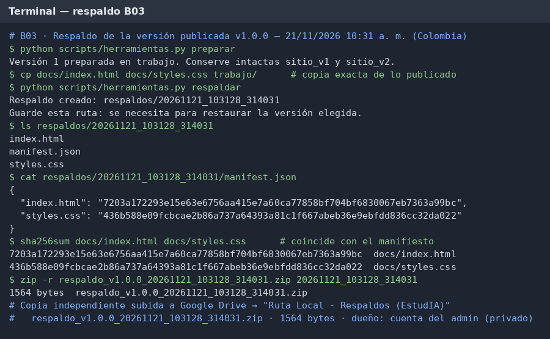
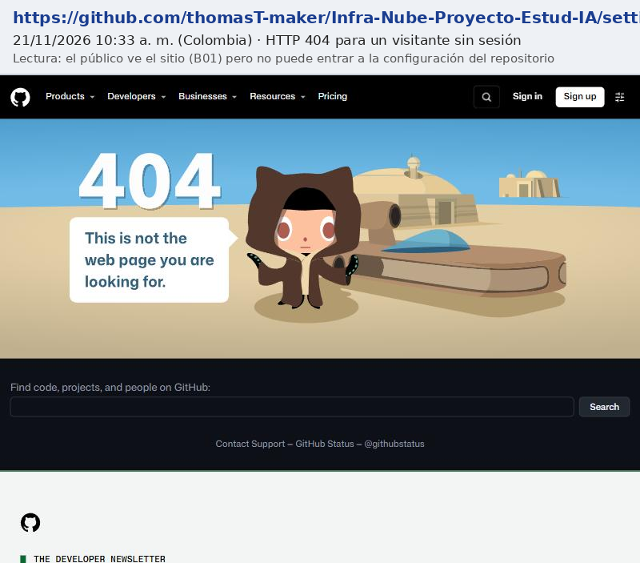
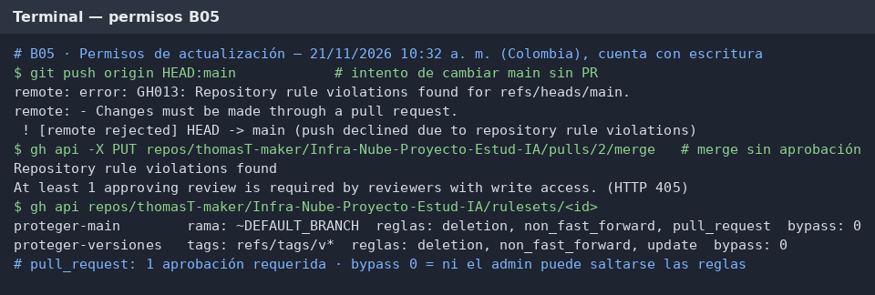

# Bitácora del equipo

Basada en `PLANTILLA_EVIDENCIAS.md` del paquete del reto. Los campos marcados con *[completar]* se llenan durante el encuentro 2. **No escribir contraseñas, tokens ni claves.** Las capturas se guardan en `documentacion/evidencias/`.

## Registro del equipo

- **Equipo:** *[completar]*
- **Integrantes y responsabilidades:** *[completar: nombre — usuario GitHub — rol (admin / revisor / actualiza / documenta / repite B06)]*
- **Fecha:** 21 de noviembre de 2026 (encuentro 2)
- **Modalidad:** nube (GitHub Pages)
- **Arquitectura elegida y motivo:** sitio estático publicado con GitHub Pages desde `/docs` de `main`, versionado con Git y tags, respaldo independiente en Google Drive. Motivos en el [README](../README.md) y el [esquema](ESQUEMA.md).
- **Ayudas utilizadas y cambios realizados:**
  - `scripts/herramientas.py` del paquete: se usa para generar respaldos con manifiesto SHA-256 y como plan B local. Git reemplaza a `actualizar` y `restaurar` en la nube.
  - **Cambio propio:** se agregó la marca `v1.0.0` en el pie de `docs/index.html` (se conserva el texto "Versión 1" del cuerpo, que pide la guía). `sitio_v1/` y `sitio_v2/` quedan intactos.
  - Los PDF y las guías del paquete no se publican en el repositorio; se guardan en Drive.
  - Se usó Claude (asistente de IA) para estructurar el repositorio y redactar la documentación; el equipo revisó y ejecutó los procedimientos.
- **Recursos, permisos y posibles costos:** ver [PERMISOS.md](PERMISOS.md) y [ESQUEMA.md](ESQUEMA.md). Costo del ejercicio: ninguno.

---

## B01 — Publicación

- **Qué queremos comprobar:** el sitio abre en la dirección pública con la versión inicial y sus estilos.
- **Versión y estado inicial:** v1.0.0 en `docs/` de `main`; Pages recién activado.
- **Pasos para repetirla:** [PROCEDIMIENTOS.md §0 y §1](PROCEDIMIENTOS.md).
- **Resultado esperado:** la URL muestra "Versión 1", el pie "v1.0.0" y el título en morado, desde ventana privada y en un navegador distinto al de configuración.
- **Resultado observado:** desde el navegador integrado de la app de Claude, **sin sesión de GitHub** (consulta pública), la URL responde HTTP 200 y muestra "Versión 1", el pie "v1.0.0" y el título en morado. `styles.css` responde HTTP 200. Encabezados: `Last-Modified: 21/11/2026 10:07:09 a. m.` (hora de Colombia) y `Cache-Control: max-age=600`, que confirma la caché de 10 minutos.
- **URL:** https://thomast-maker.github.io/Infra-Nube-Proyecto-Estud-IA/
- **Inicio, fin y duración:** Pages publicó a las 10:07 a. m.; verificación a las 10:30 a. m. del 21/11/2026.
- **Evidencia:**

  

- **¿Cumple?** Sí
- **Error encontrado y ajuste:** la captura del navegador integrado no muestra la barra de direcciones; se agregó una franja con la URL, la fecha y la hora. Pendiente: tag `v1.0.0` sobre el commit publicado `a1c62ac` (desde el entorno de Claude no se permite crear tags; lo crea el admin).
- **Resultado al repetir la prueba:** *[completar cuando otro integrante lo abra en ventana privada]*

## B02 — Actualización

- **Qué queremos comprobar:** la versión 2 se publica por PR y el cambio se ve en la URL.
- **Versión y estado inicial:** v1.0.0 publicada; respaldo B03 hecho.
- **Pasos para repetirla:** [PROCEDIMIENTOS.md §3](PROCEDIMIENTOS.md).
- **Resultado esperado:** la URL muestra "Versión 2", "Ruta de espacios verdes" y el pie "v2.0.0"; existe el tag `v2.0.0`.
- **Resultado observado:** *[completar]*
- **Inicio, fin y duración:** *[completar]*
- **Evidencia:** *[completar: enlace al PR + evidencias/B02_v2.png]*
- **¿Cumple?** *[completar]*
- **Error encontrado y ajuste:** *[completar]*
- **Resultado al repetir la prueba:** *[completar]*

## B03 — Respaldo

- **Qué queremos comprobar:** existe una copia íntegra, fuera de GitHub, con ubicación, versión y archivos identificados.
- **Versión y estado inicial:** v1.0.0, la versión publicada (copia exacta de `docs/`), antes de actualizar a v2.
- **Pasos para repetirla:** [PROCEDIMIENTOS.md §2](PROCEDIMIENTOS.md).
- **Resultado esperado:** ZIP en Drive con `index.html`, `styles.css` y `manifest.json`.
- **Ruta del respaldo local:** `respaldos/20261121_103128_314031` (21/11/2026, 10:31 a. m.)
- **Archivos incluidos:** `index.html`, `styles.css`, `manifest.json` (SHA-256 de cada archivo).
- **Ubicación en Drive y quién tiene acceso:** carpeta **"Ruta Local - Respaldos (EstudIA)"** en el Drive del admin, archivo `respaldo_v1.0.0_20261121_103128_314031.zip` (1564 bytes). Por ahora solo el admin tiene acceso. *[completar: compartir con los integrantes del equipo, sin enlace público]*
- **Resultado observado:** las huellas SHA-256 del manifiesto coinciden con los archivos publicados en `docs/`. El tamaño del ZIP en Drive coincide con el local. La copia está fuera de GitHub, el lugar que puede fallar.
- **Evidencia:**

  

- **¿Cumple?** Sí (pendiente compartir la carpeta con el equipo)

## B04 — Recuperación

- **Qué queremos comprobar:** después de un error publicado, se recupera la versión correcta y se mide el tiempo.
- **Versión y estado inicial:** *[completar: v2.0.0 publicada]*
- **Error provocado:** *[completar: p. ej. index.html reemplazado por "Catálogo incorrecto"]*
- **Pasos para repetirla:** [PROCEDIMIENTOS.md §4](PROCEDIMIENTOS.md).
- **Resultado esperado:** la URL vuelve a mostrar la versión del tag elegido, con estilos.
- **Método usado:** *[revert / restaurar desde tag / emergencia del admin]*
- **Hora de inicio (error visible en la URL):** *[completar]*
- **Hora de fin (versión correcta en la URL, ventana privada):** *[completar]*
- **Duración:** *[completar]*
- **Versión recuperada:** *[completar]*
- **Evidencia antes y después:** *[completar: evidencias/B04_error.png, evidencias/B04_recuperado.png]*
- **Pasos manuales y cuáles automatizaríamos:** *[completar]*
- **¿Cumple?** *[completar]*

## B05 — Permisos

- **Qué queremos comprobar:** lectura, actualización y administración están separadas.
- **Pasos para repetirla:** [PERMISOS.md, "Cómo demostrarlo"](PERMISOS.md).
- **Resultado esperado:** sin sesión se ve el sitio y no se edita; un push directo a `main` y el borrado de un tag `v*` son rechazados; solo el admin ve la configuración.
- **Resultado observado (21/11/2026, 10:32–10:33 a. m.):**
  - **Lectura:** sin sesión se ve el sitio publicado (ver B01). La configuración del repositorio responde **404** para el visitante anónimo.
  - **Actualización:** con una cuenta con escritura, `git push` directo a `main` fue **rechazado** ("Changes must be made through a pull request"). El merge del PR #2 sin aprobación también fue **rechazado** ("At least 1 approving review is required").
  - **Administración:** rulesets activos, configurados por el admin: `proteger-main` (rama por defecto: no borrar, no force push, PR con 1 aprobación) y `proteger-versiones` (tags `v*`: no borrar, no modificar, no force push). Ninguno tiene excepciones (*bypass*), así que ni el admin puede saltárselos.
- **Evidencia (sin credenciales):**

  

  

- **¿Cumple?** Parcial: falta probar que borrar un tag `v*` es rechazado (se hace cuando exista `v1.0.0`).
- **Limitación:** en repo personal no hay rol "solo lectura" dentro de GitHub; ver PERMISOS.md.

## B06 — Repetibilidad

- **Qué queremos comprobar:** otro integrante (que no sea el admin) repite la actualización o la recuperación solo con estas instrucciones.
- **Quién la repite:** *[completar]*
- **Procedimiento repetido:** *[actualización / recuperación]*
- **Resultado observado:** *[completar]*
- **Dudas que tuvo y qué se corrigió en la documentación:** *[completar]*
- **Inicio, fin y duración:** *[completar]*
- **¿Cumple?** *[completar]*

---

## Cierre

- **Qué funciona realmente:** *[completar]*
- **Qué quedó como propuesta o pendiente:** *[completar]*
- **Procedimiento para recrear y recuperar:** [PROCEDIMIENTOS.md](PROCEDIMIENTOS.md).
- **Limitaciones y cambios para el encuentro 3:** *[completar. Ideas: organización gratuita con roles Read/Write/Admin; automatizar el respaldo con GitHub Actions; verificación automática de la URL después de cada despliegue]*
