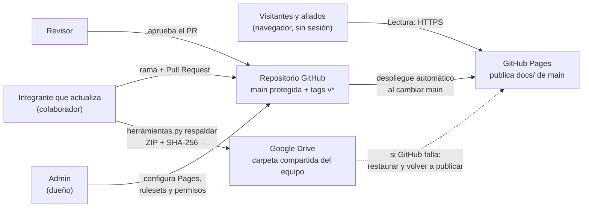

# Esquema de infraestructura

## Para qué sirve cada componente

| Componente | Función |
|---|---|
| **Navegador** | Donde visitantes y aliados consultan el catálogo. Solo lectura. |
| **GitHub Pages** | Alojamiento estático gratuito con HTTPS. Da la dirección única de consulta. |
| **Repositorio (`main`)** | Fuente de la versión vigente. Guarda el historial completo; los tags `v1.0.0` y `v2.0.0` marcan versiones recuperables. |
| **Pull Request + revisor** | Control de actualización: ningún cambio llega al sitio sin aprobación. |
| **Admin** | Único que cambia la configuración, los permisos y las reglas. |
| **Google Drive** | Copia independiente de GitHub, con huellas SHA-256 para comprobar que no se alteró. Solo tiene acceso el equipo. |

## Posibles costos

Ninguno en este ejercicio: Pages es gratuito para repos públicos y no se compra dominio. Lo que podría generar consumo en un caso real: dominio propio, superar los límites de transferencia o de almacenamiento de Pages, o almacenamiento extra en Drive. No se inventan tarifas; se consultan en la documentación oficial si llegara a aplicar.
